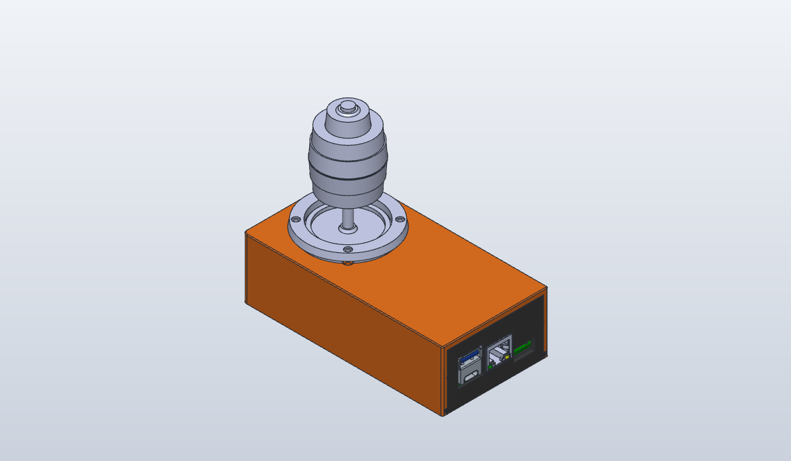

# JH-D400X-R4 joystick + ESP32-P4 PoE box

Holds a **JH-D400X-R4** 4-axis joystick in its top panel and a Waveshare
[**ESP32-P4-WIFI6-POE-ETH**](https://docs.waveshare.com/ESP32-P4-WIFI6-POE-ETH) inside, so the joystick becomes a
networked controller on one PoE cable. The RJ45, USB-C/USB-A stack and microSD come out through the base's end wall.
Loosely after the LowRiderJS box (open shell, slide-in base), without its LED and switch holes.

## Bill of materials

| Qty | Item |
|-----|------|
| 1 | `out/joystick-p4-box-shell.stl` printed (STEP alongside) |
| 1 | `out/joystick-p4-box-base.stl` printed (STEP alongside) |
| 1 | JH-D400X-R4 4-axis joystick |
| 1 | Waveshare ESP32-P4-WIFI6-POE-ETH |
| 4 | M2.5 x 16 self-tapping screw (joystick: through its ring, grommet and the panel; length estimated) |
| 4 | M2.5 x 6 pan-head self-tapping screw (board) |

## Printing

No supports, PLA or PETG. Shell panel-down: the panel top is the bed face (0.5 mm chamfer for elephant's foot), and
the grooves' 45° bevels are the only overhangs. Base plate-down; the port-window tops are short bridges. The plate
fits its grooves with 0.3 mm clearance, so check the first print slides freely.

## Assembly

1. Joystick body up under the panel, shaft through the Ø40.6 hole, potentiometers toward the closed end and the -Y
   long wall (its leads then face +Y). Grommet and ring on top; four screws down through ring, grommet and panel
   into the body.
2. Board onto the base's four posts: lower it ~2.5 mm short of the end wall (the RJ45 overhangs the board edge by
   2 mm), then slide it toward the wall until the USB stack sits in its window (it reaches the wall's outer face);
   four screws.
3. Plug the joystick leads onto the board's header. Run them and their slack along the +Y side of the joystick body
   (10 mm of room), not into the 3 mm gap between body and header.
4. Slide the base in from the open end, plate edges in the grooves, until the end wall's detents click.

## Design notes

- The base is the plate plus the port end wall. It slides in from the port end, so the board never passes under the
  joystick (that would need a ~55 mm tall box rather than 38), and the windows line up with the ports by construction.
- WIFI6-POE-ETH, not the ESP32-P4-Nano: its USB-C, USB-A, RJ45 and microSD are all on one edge, so one wall carries
  every opening; the Nano has USB-C and RJ45 on opposite edges.
- Dovetail grooves: the plate's long edges reach 1.5 mm into each wall with a 45° bevel underneath, so the plate sits
  flush with the bottom and the grooves print panel-down without supports.
- Joystick: 4 × Ø2.9 holes (M2.5 clearance) on the 33.0 mm square of the D400B model's pilots, which the user's
  "about 33" agrees with; the LowRiderJS panel's 33.25 misses them by 0.18 mm. The panel sits between body and
  grommet; the Ø40.6 hole also lets the grommet's Ø38 lip come up through from underneath instead. The countersinks
  are only used in that layout; with the ring on top the heads sit on the ring.
- Interior 32 mm under the panel: the joystick's 25.75 mm body, plus room for Dupont plugs on the header.
- Detent: a Ø1.6 bump on each shell wall at the open mouth, into a Ø1.6 dimple in each side edge of the base end
  wall. The walls are free to flex there and the drag is only the wall's 1.5 mm; near the closed end they can't.
- The base end wall is 1.5 mm and the board edge 0.2 mm inside it, so the USB stack's face (1.7 mm past the board
  edge) is flush with the outer face and plug overmolds never meet the wall. The RJ45 (2.0 past the edge) stands
  0.3 proud of it; the microSD slot is set 1.2 into the board, so its face is 2.9 behind it.
- The joystick is the GrabCAD [D400B model](https://grabcad.com/library/d400b-3-axis-joystick-with-pushbutton-1),
  turned and with grommet, ring and handle lifted by the panel's 3 mm (the model has no panel). The board is
  Waveshare's V2.0 STEP (`vendor/waveshare-esp32-p4-wifi6-poe-eth`), plus a box proxy for Dupont plugs on the header.
  Both are context for the render and the fit checks, never exported.
- The fit check takes only the board bodies that can reach the box: over 3 mm tall, past the outline, or under the
  PCB over a post or near the plate (the lowest, the underside MX1.25 speaker header, is 3.3 below the PCB). All 800
  take minutes.

## Status

First version, **not yet test-printed**. `check.py` verifies every cut, fillet and chamfer by volume, that nothing
clashes with the joystick model or the board STEP, that the panel holes line up with the joystick's pilots, that
plugs reach every port through its window, and that a 1 mm pull meets the detents. It can't verify feel. Known
issues:

- **`check.py` fails one check**: the microSD face is 2.93 mm behind the outer face, over the 2 mm allowed for a
  fingernail; Waveshare's STEP sets the slot 1.2 mm into the board, where the earlier proxy had it flush.
- Board geometry is Waveshare's V2.0 STEP and drawing (holes 10.7 from the header edge; the web drawing read 10.25),
  not measured on a board, and the board in hand may be a different revision. The STEP has no ESP32-P4-Core or
  C6 module shields (~3 mm, well under the 32 mm interior).
- Detent strength unverified: 0.5 mm interference per side, may be too weak to resist an RJ45 unplug.
- The D400B model is a GrabCAD upload, not the maker's drawing; potentiometer tips are 0.95 mm from the -X/-Y walls,
  and its rigid leads end 0.5 mm from the +Y wall (real leads bend).
- Joystick screw length (M2.5 x 16) is estimated from the model's ring, grommet and pilot depth.
- `units/d400b.step` is a GrabCAD download: check its licence before publishing the repo.

## Files

| Path | What |
|------|------|
| `joystick_p4_box.py` | Generator: every dimension is a named constant at the top |
| `check.py` | Volume, clearance, alignment, port and retention checks; must pass (`mise run check joystick-p4-box`) |
| `../vendor/waveshare-esp32-p4-wifi6-poe-eth/` | Waveshare's board STEP and drawing, context only |
| `units/d400b.step` | JH-D400 joystick model from [GrabCAD](https://grabcad.com/library/d400b-3-axis-joystick-with-pushbutton-1), context only |
| `out/` | STLs and STEPs to print, and this README's render |
