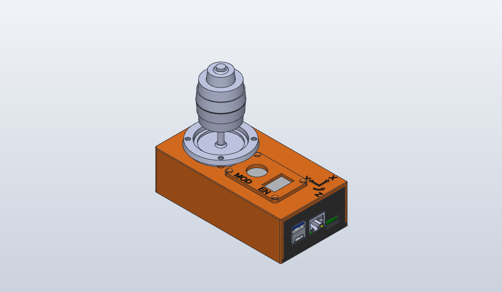

# JH-D400X-R4 joystick + ESP32-P4 PoE box

Holds a **JH-D400X-R4** 4-axis joystick in its top panel and a Waveshare
[**ESP32-P4-WIFI6-POE-ETH**](https://docs.waveshare.com/ESP32-P4-WIFI6-POE-ETH) inside, so the joystick becomes a
networked controller on one PoE cable. The RJ45, USB-C/USB-A stack and microSD come out through the base's end wall.
Two switches on a screwed-on plate over the board: a latching rocker to enable sending, and a momentary mod button that shifts
the stick's axes (e.g. lift and pitch for an arm). The stick's own centre button is left for grasp. Loosely after
the LowRiderJS box (open shell, slide-in base), without its LED.

Firmware: [zephyr-applications/joystick_controller](https://github.com/rosterloh/zephyr-applications/tree/main/applications/joystick_controller) (Pico-ROS teleop for a MoveIt Servo arm or a mobile
base); its README has the header wiring.

## Bill of materials

| Qty | Item |
|-----|------|
| 1 | `out/joystick-p4-box-shell.stl` printed (STEP alongside) |
| 1 | `out/joystick-p4-box-base.stl` printed (STEP alongside) |
| 1 | `out/joystick-p4-box-plate.stl` printed: switch plate (STEP alongside) |
| 1 | JH-D400X-R4 4-axis joystick |
| 1 | Waveshare ESP32-P4-WIFI6-POE-ETH |
| 4 | M2.5 x 16 self-tapping screw (joystick: through its ring, grommet and the panel; length estimated) |
| 4 | M2.5 x 6 pan-head self-tapping screw (board) |
| 4 | M2.5 x 6 countersunk self-tapping screw (switch plate into the panel) |
| 1 | Arcolectric (Bulgin) H8600VBAAS rocker, SPST ON-OFF latching, snap-in (enable) |
| 1 | RAFI 1.10.001.001/0301 pushbutton, Ø15.2, momentary 1 NO, screw terminals, threaded ring (mod) |

## Printing

No supports, PLA or PETG. Shell panel-down: the panel top is the bed face (0.5 mm chamfer for elephant's foot), and
the grooves' 45° bevels are the only overhangs. Base plate-down; the port-window tops are short bridges. Switch plate top-down (pocket and countersinks face up). The plate
fits its grooves with 0.15 mm clearance (0.3 on the first print let the base fall out).

## Assembly

1. Joystick body up under the panel, shaft through the Ø40.6 hole, potentiometers toward the closed end and the -Y
   long wall (its leads then face +Y). Grommet and ring on top; four screws down through ring, grommet and panel
   into the body.
2. Board onto the base's four posts: lower it ~2.5 mm short of the end wall (the RJ45 overhangs the board edge by
   2 mm), then slide it toward the wall until the USB stack sits in its window (it reaches the wall's outer face);
   four screws.
3. Wire the stick to the header as in the [firmware README](https://github.com/rosterloh/zephyr-applications/tree/main/applications/joystick_controller#waveshare-esp32-p4-wifi6-poe-eth--hzqs-r400b-m4-ethernetpoe).
   Run its leads and their slack along the +Y side of the joystick body (10 mm of room), not into the 3 mm gap
   between body and header.
4. Slide the base in from the open end, plate edges in the grooves, until the end wall's detents click. The switch
   plate must be off: the 2x20 header passes under the switches' place on the way in.
5. Switches onto their plate: rocker snapped in from the top, long side across the box; button in from the top,
   threaded ring on underneath. Solder wires to the rocker (push-on receptacles on its 4.8 mm tabs don't fit above
   the board). Feed the wires down the panel opening and plug them onto the header, just -X of the opening.
6. Plate over the opening, switches down through it; four countersunk screws into the panel.

## Design notes

- The base is the plate plus the port end wall. It slides in from the port end, so the board never passes under the
  joystick (that would need a ~55 mm tall box rather than 38), and the windows line up with the ports by construction.
- WIFI6-POE-ETH, not the ESP32-P4-Nano: its USB-C, USB-A, RJ45 and microSD are all on one edge, so one wall carries
  every opening; the Nano has USB-C and RJ45 on opposite edges.
- Dovetail grooves: the plate's long edges reach 1.5 mm into each wall with a 45° bevel underneath, so the plate sits
  flush with the bottom and the grooves print panel-down without supports.
- Joystick: 4 × Ø2.9 holes (M2.5 clearance) on the 33.0 mm square of the D400B model's pilots, which the user's
  "about 33" agrees with; the LowRiderJS panel's 33.25 misses them by 0.18 mm. The panel sits between body and
  grommet; the Ø40.6 hole also lets the grommet's Ø38 lip come up through from underneath instead. The countersinks
  are only used in that layout; with the ring on top the heads sit on the ring.
- Interior 32 mm under the panel: the joystick's 25.75 mm body, plus room for Dupont plugs on the header.
- Detent: a Ø1.6 bump on each shell wall at the open mouth, into a Ø1.6 dimple in each side edge of the base end
  wall. The walls are free to flex there and the drag is only the wall's 1.5 mm; near the closed end they can't.
- The base end wall is 1.5 mm and the board edge 0.2 mm inside it, so the USB stack's face (1.7 mm past the board
  edge) is flush with the outer face and plug overmolds never meet the wall. The RJ45 (2.0 past the edge) stands
  0.3 proud of it; the microSD slot is set 1.2 into the board, so its face is 2.9 behind it.
- USB and RJ45 windows (after the first print): the USB window is 0.2 mm round the USB-A shell's front flare, and
  the RJ45 window's edge facing it 0.2 mm from the jack, so the wall between them is 2.0, not 0.9. The flare stands
  0.85 past the shell at each side and 1 above it and leads the board through the window as the base slides in on
  its posts, so the window can't close round the shell itself (13.1 wide in the wall).
- The joystick is the GrabCAD [D400B model](https://grabcad.com/library/d400b-3-axis-joystick-with-pushbutton-1),
  turned and with grommet, ring and handle lifted by the panel's 3 mm (the model has no panel). The board is
  Waveshare's V2.0 STEP (`vendor/waveshare-esp32-p4-wifi6-poe-eth`), plus a box proxy for Dupont plugs on the header.
  Both are context for the render and the fit checks, never exported.
- The fit check takes only the board bodies that can reach the box: over 3 mm tall, past the outline, or under the
  PCB over a post or near the plate (the lowest, the underside MX1.25 speaker header, is 3.3 below the PCB). All 800
  take minutes.

- Switches sit over the board at y 25, between the header plugs and the RJ45 and -Y of the 12 mm PoE transformer
  (y 36.8 up): there the board's parts are under 3 mm, so their bodies clear it; nothing fits beside the
  joystick. The rocker runs across the box so the 15 mm button fits beside it (35 of the 40.8 mm free in X).
- The switches are on a 3 mm plate screwed over a panel opening, fitted after the base is in: as the base slides,
  the 2x20 header passes under their place: its pins reach z 18.9 (16 mm below the panel), the Dupont plugs
  higher, and the switches need ~22 (found on the first print). The plate sits proud of the panel; the opening also gives
  access to the header for the switch wires.
- The rocker's snap clips take 2.00-3.00 mm panels (cutout 19.8 x 12.9 for that band), so a pocket thins the
  plate to 2.5 mm, mid-range. The cutout is 0.2 under that, 19.6 x 12.7: the catalogue size rattled when printed.
  The mod button is raised so it can be found by feel without looking.
- Rocker latching, not momentary: it enables the controller rather than being held. So the firmware sends nothing
  after boot or a link drop until the rocker has been seen off, and nothing after enabling or a mod change until
  the stick has been centred.

## Status

First print done: base too loose, rocker rattled, USB/RJ45 wall too thin, and the switches blocked the base
sliding in; the fixes above (switch plate included) are **not yet printed**. `check.py` verifies every cut, fillet
and chamfer by volume, that nothing (switch bodies included) clashes with the joystick model or the board STEP, that
the board slides in under the panel, that the panel holes line up with the joystick's pilots, that plugs reach every
port through its window, and that a 1 mm pull meets the detents. It can't verify feel. Known
issues:

- Switch bodies are box proxies, not vendor models: rocker 15 x 21 x 21.9 (2 mm for soldered wires), button
  20 square x 21.5 from the plate underside (18.5 measured). RAFI's datasheet gives neither the threaded ring's size nor its
  panel range; a 20 mm ring and a 3 mm panel are assumed.
- Rocker cutout and slide clearance are retuned from one print, not yet reprinted.
- Board geometry is Waveshare's V2.0 STEP and drawing (holes 10.7 from the header edge; the web drawing read 10.25),
  not measured on a board, and the board in hand may be a different revision. The STEP has no ESP32-P4-Core or
  C6 module shields (~3 mm, well under the 32 mm interior).
- Detent strength unverified: 0.65 mm interference per side (0.5 on the first print, which fell out); a bigger
  bump cuts through the 1.5 mm end wall.
- The D400B model is a GrabCAD upload, not the maker's drawing; potentiometer tips are 0.95 mm from the -X/-Y walls,
  and its rigid leads end 0.5 mm from the +Y wall (real leads bend).
- Joystick screw length (M2.5 x 16) is estimated from the model's ring, grommet and pilot depth.
- `units/d400b.step` is a GrabCAD download: check its licence before publishing the repo.

## Files

| Path | What |
|------|------|
| `joystick_p4_box.py` | Generator: every dimension is a named constant at the top |
| `check.py` | Volume, clearance, alignment, port and retention checks; must pass (`mise run check joystick-p4-box`) |
| `../vendor/waveshare-esp32-p4-wifi6-poe-eth/` | Waveshare's board STEP and drawing, context only |
| `../vendor/hzqs-r400b/` | Maker's R-series catalogue pages (R400B: pots, travel, install holes), context only |
| `units/d400b.step` | JH-D400 joystick model from [GrabCAD](https://grabcad.com/library/d400b-3-axis-joystick-with-pushbutton-1), context only |
| `out/` | STLs and STEPs to print, and this README's render |
