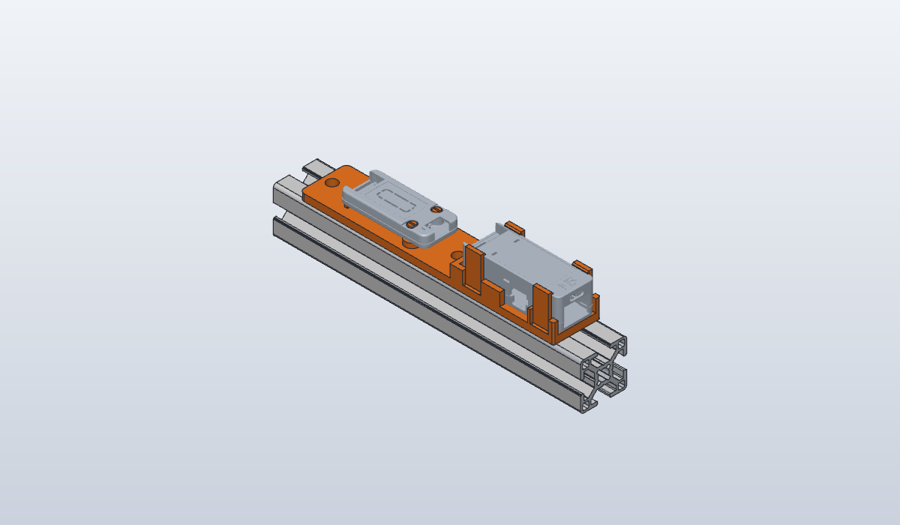

# PoE-P4 + RS485-ISO 30x30 extrusion mount

Holds an M5Stack [**Unit PoE-P4**](https://docs.m5stack.com/en/unit/Unit_PoE-P4) and
[**Unit RS485-ISO**](https://docs.m5stack.com/en/unit/Unit_RS485-ISO) in line on **RS PRO 264-7862** 30x30 slot-8 aluminium
extrusion, with their Grove ports joined by a cable.

## Bill of materials

| Qty | Item |
|-----|------|
| 1 | `out/poe-rs485-3030-mount.stl` printed (STEP alongside) |
| 2 | M6 screw (cap or button head, ~10 mm) + M6 drop-in T-nut for slot 8 |
| 1 | Grove cable, 10 cm or longer |

## Printing

Plate down, no supports, PLA or PETG. The only overhangs are the 1.1 mm hooks on the snap tabs. Fits are 0.3 mm
clearance, so check the first print for elephant's foot (the plate has a 0.5 mm bottom chamfer for it).

## Assembly

1. Drop two T-nuts into the extrusion's top slot and bolt the bracket down. Both holes are clear of the units.
2. Snap the PoE-P4 in from above, RJ45/USB-C end to the open end. A rib engages the slot across its base.
3. Press the RS485-ISO, cover up, onto the two pegs until the ridges click into its LEGO holes.
4. Run the Grove cable out of the PoE's side (notch in the front wall), round its closed end, into the RS485.

## Design notes

- In line along the extrusion, so everything stays inside the 30 mm face; a T layout across it overhung ~26 mm.
- Nothing at or past the PoE's +X face (RJ45 and USB-C). The PoE's Grove port is on its -Y face (18 mm wall notch for
  the plug and cable bend); its side button is on +Y (10 mm notch).
- PoE: four snap tabs (10 x 2 mm, 0.8 mm hook with 45° lead-in, relief slots, r0.9 outer / r0.5 inner root fillets;
  ~0.6% strain to snap), an end stop at -X and an X-lock rib in the 3.2 mm through-slot across its base.
- RS485: LEGO-pin style pegs on 3 mm bosses: Ø4.8 shaft up its Ø4.85 bore, Ø5.3 ridge that snaps into the top Ø6.2
  counterbore, 1 mm slot so the ridge squeezes through. A pad supports its far end. No heat-set inserts, by choice.
- The far M6 hole sits 16 mm past the RS485 so the screw head clears its terminal wires.
- RJ45-end corners are r1, not r3: those edges run up the 3 mm walls.

## Status

First version, **not yet test-printed**. `check.py` verifies every cut and fillet by volume, that no bracket
material enters either unit, and that both units are held; it can't verify feel. Known issues:

- To be confirmed in print: peg ridge squeeze, snap-tab fit, the 0.3 mm clearances.
- Unconfirmed from the CAD: that nothing in the real PoE occupies the base slot the X-lock rib uses, and which RS485
  face is the cover.
- The M6 hole between the units sits under the Grove cable; push the cable aside to reach it.
- 1.6-2 mm wall slivers between the tab slots and the port notches are fragile.
- Code: `wall_segments` can return an inverted segment if two gaps lie past its end (current dimensions never do);
  the hook lead-in chamfer has no volume check of its own.

## Files

| Path | What |
|------|------|
| `poe_rs485_3030_mount.py` | Generator: every dimension is a named constant at the top |
| `check.py` | Volume, clearance and retention checks; must pass (`mise run check poe-rs485-3030-mount`) |
| `units/` | M5Stack unit meshes from [m5stack/M5_Hardware](https://github.com/m5stack/M5_Hardware) (MIT, see `units/LICENSE-M5Stack`), trimmed to the assembled shells by `trim.py` |
| `out/` | STL and STEP to print, and this README's render |
