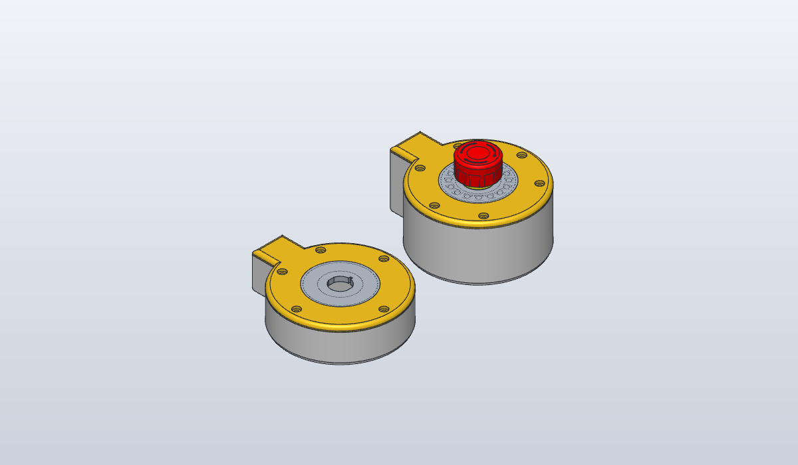

# Protective-stop remote (S3 and P4)

Polymath Robotics' [protective-stop](https://github.com/polymathrobotics/protective-stop) E-stop remote, rebuilt as a
generator in two variants: a round base with an NKK FF01 E-stop in the lid, a 16-LED WS2812 ring under a diffuser, and
a side pod for the board.

- **s3**: Polymath's own design for the Waveshare ESP32-S3-ETH, matched to their STLs. The baseline the generator is
  checked against.
- **p4**: the same remote for a Waveshare **ESP32-P4-POE-ETH** (headers fitted, PoE Module (B)), one PoE cable for
  power and network. The board is mounted flipped (pins up), so Dupont sockets plug on from above with the lid off.

Polymath's design is CERN-OHL-P-2.0; these variants are derived from it under the same licence.

## Bill of materials

Each variant prints `out/protective-stop-remote-<variant>-{base,lid,diffuser}.stl` (STEP alongside). For Polymath's
two-colour lid, open `out/protective-stop-remote-<variant>-lid.3mf` instead of the lid and diffuser STLs: it holds both,
aligned, as separate objects, so the slicer can give the diffuser white and the lid its colour and print them as one.

| Qty | s3 | p4 |
|-----|----|----|
| 1 | Waveshare ESP32-S3-ETH + PoE Module (B) | Waveshare ESP32-P4-POE-ETH, with headers and PoE Module (B) |
| 1 | NKK FF0126BBCAEA01 E-stop (2NC) | same |
| 1 | WS2812B ring, 16 px (Ø44.3) | same |
| 5 / 6 | M3 heat-set insert + M3 socket-head screw (lid) | 6 |
| 4 / 2 | M1.6 heat-set insert (board) | 2, in the module posts |
| - | wire, soldered to the board | 7 female Dupont jumpers |
| - | - | 2 × M1.6 × 20 screws (pin side → board → module → post); 2 × M1.6 × 5 self-tapping (board posts) |
| - | - | 90° USB-C adapter or cable, for flashing with the lid off |

Screw lengths for the p4 are from the stack (1.6 PCB + 13 transformer gap + 1.66 module + insert), not tried.

## Printing

No supports. Base floor-down, lid and diffuser face-down (the 3MF is already face-up as modelled: flip it in the
slicer). Polymath printed the lid in yellow PLA with the diffuser in
white; any PLA/PETG works, with heavy walls (they used 6) since the lid takes every press of the button.

## Assembly

s3: as Polymath's [assembly guide](https://polymathrobotics.github.io/protective-stop/hardware/assembly).

p4:

1. Heat-set the inserts: M3 into the six lid posts, M1.6 into the two short module posts.
2. Fit the PoE module to the board. Turn the board over (components down) and lower it into the channel, RJ45 against
   the end wall's window, the module on its two posts.
3. Screw the M1.6 × 20 screws down from the pin side through the board and the module into the module posts; the
   transformer's pad bears on the board, so snug is enough. M1.6 × 5 self-tapping into the two thin posts at the
   USB-C end.
4. Button and ring into the diffuser as Polymath's guide (ring LEDs up, snapped over the four bumps), diffuser into the
   lid.
5. Dupont sockets onto VBUS (pin 40), GND (pin 28) and GPIO27, 32, 33, 46, 47 (pins 27, 26, 25, 24, 22): those keep
   every socket clear of the button. The firmware's pin choice is open, see Status.
6. Lid on, six M3 screws. To flash: lid off, 90° USB-C adapter into the board's USB-C (facing the body's centre).

## Design notes

- p4 is flipped so the header pins face the lid: sockets plug on from above and the board stays screwed down. The
  RJ45 and PoE module hang toward the floor; the RJ45 opens low in the pod's end wall.
- p4's height comes from the board: pin tips plus 1 mm must pass under the FF01's terminals (13.6 behind its panel),
  and sockets (16.5 above the PCB, assumed) plus 6 mm of wire bend must fit under the lid. The pins win: the lid
  underside is at 42.2 against Polymath's 24.1 (`p4_height` prints both).
- Polymath's screw-through mount, reversed: on their s3 the screws go down through module and board into the base;
  on the p4 they go from the pin side through board and module into posts under the module's far face.
- p4's posts at the board's USB-C end are Ø3.4 with a pilot for a self-tapping screw: those holes are 1.8 from the pin
  header, so a post wide enough for an insert hits it.
- p4's end-wall window is the jack's mouth plus 0.5, smaller than the jack, so pulling a plug out bears the jack's face
  on the wall. Pushing one in drives the board inward: two lugs at its USB-C end's corners take that, with 0.34 of
  play (closer to the thin posts, the kernel fails on the near-touching faces).
- Nothing on the FF01 moves below its panel (the cap travels above it), so the only below-panel clearance is to its
  fixed body: covered by the fit check, with the pin tips 1 mm under its terminals.
- p4 has no channel end wall (the board runs past the centre) and its lid post at (84, 9) became two at ±40°: it sat
  where the USB-C adapter goes.
- The PoE Module (B) has no published model: it's a box from the user's measurements (36 × 21, far face 14.7 from the
  main PCB, transformer pad resting on the main board).
- s3 differs from Polymath's STLs where the kernel made matching expensive: their standoffs' r2 feet are left off (a
  robust join took 5 minutes), the diffuser's ring snaps are blocks rather than curved, the pod box reaches 0.5 into
  the body wall below its bottom fillet, and their logo isn't modelled. Their lid's underside sits 0.1 into the base's
  rim in their STLs; s3 keeps that, p4 doesn't.

## Status

Not printed. `check.py` verifies each feature by volume, matches s3's base and lid to Polymath's STLs within 0.5 mm
(diffuser reported, not required), and checks the p4's fit: no clash between case, board STEP, module, socket and
adapter stand-ins, button and ring; a plug reaches the jack; the jack bears on the wall when a plug is pulled and the
board on its stop lugs when one is pushed in; the module screws pass through the board's and the module's holes into
the posts. Any interference query the kernel can't finish fails the check, except two open part bodies in Waveshare's
STEP. Known issues:

- p4 pin set is a placeholder until the firmware is ported to the P4 (Polymath's targets the ESP32-S3 + W5500); VBUS
  is fixed, the rest can move as long as sockets stay ≥ 13.3 mm from the button axis.
- Dupont socket height (16.5) and the 90° USB-C adapter's size are assumptions; the module's hole position on its PCB
  (2 mm from its edge) is read from photos.
- Waveshare's STEP models one of the two pin rows.

## Files

| Path | What |
|------|------|
| `protective_stop_remote.py` | Generator: `VARIANTS` holds every dimension; p4's are derived from s3's in `p4_variant` |
| `check.py` | Volume, match and fit checks; must pass (`mise run check protective-stop-remote`) |
| `../vendor/polymath-protective-stop/` | Polymath's STLs and STEPs (reference and context only) |
| `../vendor/waveshare-esp32-p4-eth/` | Waveshare's ESP32-P4-ETH STEP (Git LFS) |
| `out/` | STL and STEP to print, and this README's render |
