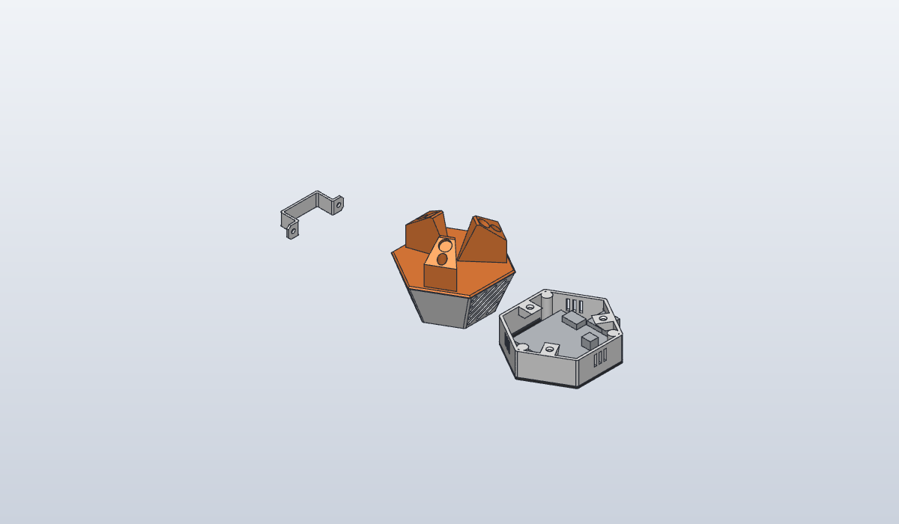

# Prusa Core One camera case (ESP32-CAM and DFR1154)

A camera for the inside top corner of a Prusa Core One, for the
[`prusa_cam`](https://github.com/rosterloh/zephyr-applications/tree/main/applications/prusa_cam) firmware. A hex plate
sits in the corner on three magnets, and a cup holding the camera screws under it with three M3 screws.

- **esp32cam**: the [Prusa Core One ESP32 camera case](https://www.printables.com/model/1205313-prusa-core-one-esp32-camera-case)
  from Printables (plate, cup for the AI-Thinker ESP32-CAM, U-bracket), rebuilt as a generator and checked against
  its STLs. Licence not confirmed; the STLs are not in this repo.
- **dfr1154**: a new two-part cup for the DFRobot [DFR1154](https://wiki.dfrobot.com/dfr1154) (ESP32-S3, OV3660 160°
  lens, IR LEDs, mic, ambient light sensor) that screws onto the same plate, so an installed plate stays where it is.
  An open-ended **shell** carries the plate joint. An open **front frame** carries the board and a collar round the
  lens, and slides into the shell's open end.

## Bill of materials

| Qty | esp32cam | dfr1154 |
|-----|----------|---------|
| 1 | `out/prusa-core-one-camera-plate.stl` (shared) | the same plate, already installed |
| 1 | `out/prusa-core-one-camera-esp32cam-cup.stl` | `out/prusa-core-one-camera-dfr1154-cup.stl` (shell) |
| 1 | - | `out/prusa-core-one-camera-dfr1154-front.stl` (front frame) |
| 1 | `out/prusa-core-one-camera-bracket.stl` (optional) | - |
| 3 | Ø8 × 3 round magnets | same |
| 3 | M3 × 6 self-tapping screws, plate to cup | same, plate to shell |
| 4 | - | M3 × 6 self-tapping screws, board to front frame |
| 3 | - | M3 × 6 self-tapping pan head screws, front frame to shell |
| 1 | AI-Thinker ESP32-CAM | DFRobot DFR1154 + straight USB-C cable |

STEP files sit beside each STL.

## Printing

No supports. PETG or ASA, not PLA: the chamber gets warm enough to soften it. Plate legs up. The esp32cam cup front
face down. The dfr1154 shell **rim down** (joint face on the bed: its bosses then stand on the bed); the front frame
**face down**.

## Assembly (dfr1154)

1. Lay the board on the front frame camera side down, the module through the collar, the logo edge toward the
   corner with the single screw hole (the other two are on the USB side). Screw it onto the four posts.
2. Push the front frame into the shell's open end, its lip inside the walls, the USB-C connector toward the shell's
   USB slot. Three screws from the camera side into the shell's corners.
3. Plug the USB-C cable through the slot.
4. Unscrew the old cup from the plate. Screw the shell on in the position that leaves the USB slot at the bottom.
   The picture is upright when the logo edge points up. If it comes out upside down, set vflip and hflip in the
   firmware. The firmware's rotation setting only fixes Prusa Connect and snapshots, not the stream.

## Design notes

- The joint (rim outline, three Ø2.5 × 4 pilots with a 1 mm lead-in at radius 25.91, angles 180° and ±60°) is the
  original cup's. `check.py` compares the two there.
- Straight hex rather than the original taper. The 42 mm board needs ~59 mm across the flats inside, which the
  tapered cup only has in its last few mm, and with the board that deep the 160° lens would see the walls.
- Two parts because the board can't get into a one-piece cup: the 42 mm board overlaps the screw circle however it
  is turned, so the ±60° plate-joint bosses sit over its edge. The board goes in from the camera end on its front
  frame instead, and `check.py` sweeps the board's outline out of the shell's open end to prove it.
- The front is an open frame, not a plate: a rim with the lip, the four board posts on stubs from the rim, and one
  bar from the logo edge to the USB edge carrying a collar round the camera module. A closed face 6 mm in front of
  the IR LEDs needed flared windows, tubes round the mic and light sensor and tape round the module, all to manage
  IR inside the case; with the face open there is no inside. It also prints flat with no overhangs, and only the
  lens, posts and USB positions have to be right.
- The bar runs along the board's middle because the LEDs sit 15.5 mm either side of it; arms from the lens to the
  posts would cross the LEDs' light. `check.py` holds each LED's light to at least 60° outward, 40° up and 30° down
  (the posts are what limit it) and keeps the mic and light sensor clear straight ahead.
- The lens sits 0.2 mm behind the face, so nothing crops the 160° view: `check.py` finds no frame and no screw
  head within 80° of the lens axis at any azimuth, so 160° may be the picture's diagonal or its long side. The
  nearest screw head (pan head, Ø6 × 2.4) is 82° off axis: use low heads.
- The plate-joint bosses are 6 mm gussets hanging from the rim (the original's are 8). The +60° one sits over the
  USB plug, and that sets the depth (20.4 mm, front face to rim). The slot and the boss leave 1 mm round a 12.5 × 7 mm plug, because overmoulds vary.
- Vents: three slots in each wall without a boss or the USB slot, behind the board.
- The original's vents were placed by hand per wall, so the generator keeps a table per wall.

## Status

Not printed. **The DFR1154 dimensions are estimates** from DFRobot's function diagram and dimension drawing (PCB
v1.0). Before printing, measure the board and update the constants at the top of the generator:

- `CAM_H` (lens front above the PCB) and `CAM_BODY` (the module's footprint): these set the posts and the module
  hole. The depth then follows `CAM_H`, `USB_Z` and the plug height, or `BACK_H` (screw terminal) once that is the
  taller of the two.
- `USB_X`, `USB_Z` and the plug size, plus the positions of `CAM`, `IR`, `MIC`, `ALS` and `BACK_PARTS`.
- The PCB revision: a v1.1 board may have a different layout.

Known issues:

- Unconfirmed: whether 160° is the diagonal (the case stays out of an 80° cone either way) and the LEDs' own beam
  angle (not published). Nothing of the case limits either now, so neither needs a reprint.
- The board's camera side is open to the chamber. The rim stands 6.5 mm proud of it and the camera looks down, but
  a filament string could land on it.
- The bar passes about 2 mm from the light sensor and the posts could hit small parts on the board's camera side
  that DFRobot's diagram doesn't show.
- The collar is sized from an estimated 9 × 10 mm module with 0.5 mm all round, so it guards the lens without
  holding it. Once the module is measured it can be made a fit.
- The esp32cam rebuild is matched to the STLs (≤0.1 % surface misses at 0.5 mm, volume within 0.5 %). The
  Printables licence hasn't been checked (the page refused automated access).

## Files

| Path | What |
|------|------|
| `prusa_core_one_camera.py` | Generator: every dimension is a named constant at the top |
| `check.py` | STL match (esp32cam, reads the STLs from `$PRUSA_CAM_REF`, default `~/Downloads/3D`; SKIP when missing), cut volumes, the dfr1154 joint, fit and openings; must pass (`mise run check prusa-core-one-camera`) |
| `out/` | STL and STEP to print, and this README's render |
