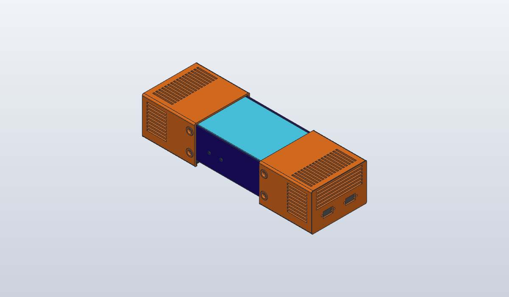

# reBot B601-RS power supply covers for a Mean Well HRPG-600-48

End caps and bottom covers that turn a bare **Mean Well HRPG-600-48** into the power supply for a Seeed
[reBot Arm B601-RS](https://github.com/Seeed-Projects/reBot-DevArm/tree/main/hardware/reBot_B601_RS). They are adapted
from Seeed's covers, which are designed for a different supply that wasn't available. The HRPG has its AC and DC
terminals at opposite ends, so there is one cap per end: the AC cap holds an IEC inlet with a switch, and the DC cap
holds two XT60 outputs.

## Bill of materials

| Qty | Item |
|-----|------|
| 1 | `out/rebot-psu-covers-ac-cap.stl` printed (STEP alongside) |
| 1 | `out/rebot-psu-covers-dc-cap.stl` printed |
| 2 | `out/rebot-psu-covers-cover.stl` printed (the same part at both ends) |
| 1 | Mean Well HRPG-600-48 |
| 1 | IEC inlet with switch, 27.2 x 47 mm body, two fixing holes at 40 mm pitch (the one measured, see Design notes) |
| 2 | XT60 panel connector, each with 2 x M3 x 8 screws and 2 x M3 nuts |
| 8 | M4 x 8 countersunk screw (side fixings, four per cap) |
| 4 | M4 x 10 countersunk screw (covers, two each) |
| 2 | M4 bolt, nut and washers for the IEC flange (length to suit flange + 3.2 mm panel) |
| 12 | Insulating shim washer: about 1 mm for the side fixings and 1.2 mm for the underside, adjusted to the measured gaps |

## Printing

PETG. Print one of each cap and two covers. The STLs are already in print position on z=0 (the STEPs stay in
assembly position), so don't let the slicer auto-orient them. Caps stand on their connector face (115 x 76.9 mm
footprint, 107.5 mm tall). Covers lie flat on their countersunk face. No supports are expected: with the caps standing
up, the vent slots run vertically and only bridge 3 mm. Check the slicer preview at the side screw seats and at the
XT60 nut pockets anyway. Use a brim if a cap lifts. Designed for a 0.4 mm nozzle and 0.2 mm layers.

## Assembly

1. Do a cold, unpowered fit check first: compare the chassis and its holes with the drawing, and check the inlet, the
   XT60 backs, the insulated terminal boots, cable bend room and the fan's clearance.
2. Fit the IEC inlet (through-bolts) and the two XT60s (with Seeed's original M3 screws and nut pockets).
3. Slide a cover into each cap's rails from the open, chassis-facing end.
4. Push each cap onto its end of the PSU and fix it with four M4 x 8 at the sides and two M4 x 10 up through the
   cover, with shims in the gaps.
5. **Screws must not reach past 4 mm into the side holes or 6 mm into the underside holes** (Mean Well's limits).
   Measure this with the screws seated and the shims fitted. The nominal engagement is 3 mm at the sides and 4.8 mm
   underneath.

## Design notes

- Ported from the Fusion script "RebotFit" revision 4 (2026-09-30), built with Codex in Fusion. The generator
  reproduces all three of that revision's parts: `inspect.compare` found each one identical within 0.002 mm, and
  `check.py` pins their volumes.
- Chassis sizes and holes come from Mean Well's Case 977A drawing (2024-10-30): 218 x 105 x 63.5 mm. The side holes
  are 32.8 mm from each end at heights 12.5 and 50.8. The underside holes are 32.8 mm from each end at y ±31.75.
- Clearance to the chassis: 1 mm at the sides, 1.5 mm at the roof and 1.2 mm underneath, filled with shims. The
  drawing's +1 mm tolerance on height still leaves 0.5 mm at the roof.
- Walls are 3.2 mm. Each side screw seat is a 4 mm pad with a 45° flare and leaves 1.8 mm behind the countersink.
  Seeed's original countersinks left about 0.2 mm. Bores are Ø4.5 with Ø8.9 x 90° countersinks.
- Covers are 4 mm thick, with 0.3 mm clearance above and below in the rails and 0.4 mm at each side. They slide out
  for servicing. Both ends use the same cover.
- DC cap: Seeed's XT60 panel (aperture, fixing holes, nut pockets) is cut out of their `RS-power-Top Cover` STEP and
  set into the front face twice, 46 mm apart. Its fit geometry is unchanged.
- AC cap: the IEC inlet sold for the Seeed design wasn't available. The opening is sized from the user-measured
  replacement body (27.2 x 47 mm plus 0.3 mm per edge, so 27.8 x 47.6). It is upright, centred at y -27, z 30, with
  Ø4.5 fixing holes at y -47 / -7. The screw line being centred on the body height was read off a product photo.
  The front vents start at y 2 so the flange sits on solid panel.
- Vents (side, roof, front) all sit beyond the chassis end, clear of the terminal projections, which Mean Well gives as
  12 mm max at AC and 18 mm max at DC.
- Print tuning on top of the Fusion revision (PETG):
  - r3 fillets on each cap's four long outer edges, which stand vertical in print, against corner lift.
  - 0.5 mm elephant's-foot chamfers on every bed face: the cap fronts, the IEC opening's edges (its fit allowance is
    only 0.3 mm) and the cover undersides (whose edges ride in rails with 0.3 to 0.4 mm play).
  - 1 mm lead-ins on the rail and lip ends, where the cover enters.
  - Clearances are unchanged for PETG.
- `units/hrpg-600.stp` is Mean Well's shared HRPG/MSP-600 model, used for the render and the fit checks. It is placed
  with x = 263.077829 - sx and y = 114.857686 - sy. Its open fan surface (`表面1`) is not a solid, so the checks
  leave it out.

## Status

Revision 4 geometry plus print tuning, **not yet printed or fitted**. `check.py` verifies:
- every cut, fillet and chamfer by volume, and that the parts matched the Fusion revision before tuning;
- the STLs sit on the bed at their print heights;
- no clash with any solid in Mean Well's model;
- all 12 fixing holes line up with the model's M4 holes;
- the covers slide and are held up by the rails.

Known issues:

- To be confirmed on the real parts: the IEC inlet's fit and its screw line (taken from a photo), the 0.3 mm cover
  slide fit and the side-hole positions against the ±1 mm drawing tolerance. Ø4.5 doesn't absorb every ±1 mm error,
  so check the hole pattern before printing the full set.
- Not modelled: the IEC and XT60 backs, the wiring, and the inlet's terminals behind its 20.3 mm body. That leaves
  32.7 mm to the AC terminal plane, before cables.
- Mechanical geometry only. Mains insulation, touch protection, protective earth, strain relief and material fire or
  temperature ratings must be resolved on the real assembly before it's powered. Don't reuse Seeed's LRS wiring
  diagram for the HRPG's terminals.

## Files

| Path | What |
|------|------|
| `rebot_psu_covers.py` | Generator: every dimension is a named constant at the top |
| `check.py` | Volume, regression, fit and slide checks; must pass (`mise run check rebot-psu-covers`) |
| `units/seeed-top-cover.stp` | Seeed `RS-power-Top Cover.stp`, source of the XT60 panel (CERN-OHL-W-2.0, see `units/LICENSE-Seeed`) |
| `units/hrpg-600.stp` | Mean Well `HRPG,MSP-600.stp` from [HRPG-600-3D.zip](https://www.meanwell.com/upload/pdf/HRPG-600/HRPG-600-3D.zip), unmodified (SHA-256 `be10aed4…6f8ab`); Mean Well's, not relicensed |
| `out/` | STL and STEP to print, and this README's render |

The printed parts are derived from Seeed's CERN-OHL-W-2.0 design and remain under that licence.
